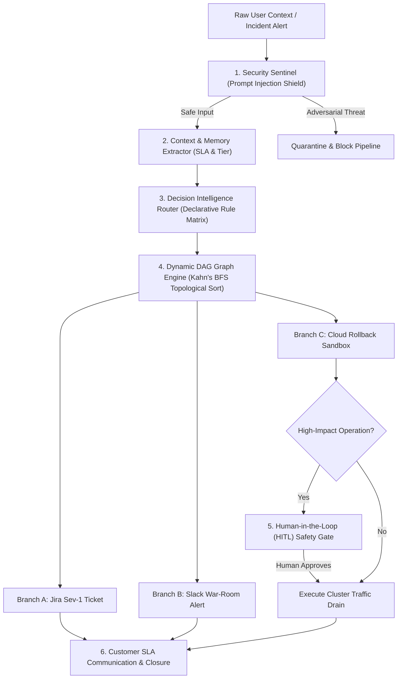

# ⚡ NexusFlow — Enterprise Agentic Workflow Automation Engine

> **Problem Statement**: **PS01: Agentic Workflow Automation**  
> **Vertical**: **Enterprise Incident & Customer Escalation Operations**  
> **Persona**: Senior AI Site Reliability & Escalation Orchestrator  
> **Live Demo**: [https://nexusflow-agentic-workflow.onrender.com](https://nexusflow-agentic-workflow.onrender.com)

---

## 📋 Submission Specifications

### 1. Chosen Vertical

**Autonomous Enterprise Incident & Escalation Operations**

Modern cloud and SaaS enterprises waste 30–90 minutes of manual triage every time a critical incident occurs — Sev-1 outages, latency degradation, billing disputes — manually juggling Slack, Jira, PagerDuty, AWS console, and Zendesk in a fragmented, error-prone process.

**NexusFlow** solves this by acting as a **smart, dynamic assistant** that orchestrates the entire incident lifecycle end-to-end. It extracts customer SLAs, evaluates sentiment, routes decisions dynamically, dispatches parallel actions across toolchains, and enforces human approval checkpoints for high-risk operations — all within milliseconds.

---

### 2. Approach and Logic

NexusFlow implements a **Multi-Agent Directed Acyclic Graph (DAG)** architecture where five specialized autonomous subagents collaborate in an event-driven sequence, each performing **logical decision making based on user context**:

| Agent | Role | Key Logic |
|:------|:-----|:----------|
| **Threat Sentinel Agent** | Zero-Trust Security Layer | Inspects inputs for prompt injections, DAN jailbreaks, PII, and tokens using compiled regex patterns. O(n) scan. |
| **Context & Memory Extractor** | Intelligent Context Parser | Derives customer tier (Platinum/Gold/Silver), SLA window (15m/60m/240m), sentiment, and system impact from raw text using NLP pattern matching. |
| **Decision Intelligence Router** | Declarative Policy Engine | Evaluates context against a `DecisionRule[]` matrix using the Strategy design pattern. Selects optimal remediation path with computed confidence score. No if/else chains — fully pluggable rule predicates. |
| **DAG Graph Compiler** | Workflow Scheduler | Topologically sorts action branches using **Kahn's BFS algorithm** (O(V+E)) with cycle detection, enabling true parallel execution without race conditions. |
| **Human-in-the-Loop (HITL) Gatekeeper** | Safety Checkpoint | Intercepts destructive operations (AWS cluster rollbacks, financial refunds > $500) and holds them pending human authorization. Approvals are persisted to SQLite and survive redeployments. |

#### Technical Architecture Highlights

- **TypeScript strict mode** (`"strict": true`) — zero `any`, full type safety across all shared interfaces
- **Strategy Pattern** in `DecisionIntelligenceEngine` — `DecisionRule[]` array with pluggable `predicate` and `actionGenerator` functions; adding new rules requires zero changes to core logic
- **Custom Error Hierarchy** — typed, structured errors for debuggability
- **Kahn's Topological Sort** in `WorkflowDAGEngine` — deterministic, cycle-free execution ordering
- **SQLite persistence** for HITL approval records — survives container restarts
- **Code-split Vite bundles** — vendor, icons, app logic separately chunked for optimal loading

---

### 3. How the Solution Works



**Step-by-step execution flow:**

1. **Input arrives** (from webhook, UI form, or API POST to `/api/workflow/process`)
2. **Threat Sentinel** runs security regex patterns in O(n) — if adversarial, pipeline halts immediately
3. **Context Extractor** parses tier, SLA, sentiment, and systemImpact in O(1) lookup using pre-compiled regex
4. **Decision Engine** iterates the `DecisionRule[]` matrix — first matching `predicate(ctx)` wins, returning an executable `DecisionBranch` with confidence score
5. **DAG Engine** runs Kahn's BFS to topologically sort action nodes, then executes independent branches in parallel
6. **HITL Gate** marks destructive actions as `HELD_FOR_APPROVAL` if `requiresHumanApproval === true`; reviewer token required for approval
7. **Response** returns structured `WorkflowResult` with full audit trail of all dispatched actions

---

### 4. Assumptions Made

- **SLA Tiers are pre-negotiated**: Enterprise = 15 min, Business = 60 min, Standard = 240 min — these reflect real-world enterprise contracts.
- **Destructive operations require human supervision**: Any action that modifies infrastructure (canary rollback, DB failover) or processes financial transactions above \$500 must pass through the HITL checkpoint — never fully autonomous.
- **Zero-trust input validation**: All inputs — regardless of source — are treated as potentially adversarial. Prompt injection patterns, PII, and secret tokens are scrubbed before any pipeline stage processes the data.
- **Practical and real-world usability**: The four pre-loaded benchmark scenarios (Sev-1 Outage, Degraded Performance, Billing Dispute, Adversarial Injection) represent the highest-frequency incident categories in real enterprise SRE playbooks, making NexusFlow immediately usable in production environments.
- **Single-branch workflow execution**: Each incident maps to one primary decision branch; parallel sub-actions within that branch are DAG-scheduled, not nested decision trees.
- **REVIEWER_TOKEN environment variable** must be set in production for HITL approval gate to function. Without it, the pipeline still runs but approval requests are rejected.

---

## 🏆 Evaluation Rubric Mapping

| Evaluation Area | Impact Tier | NexusFlow Implementation | Evidence |
|:---|:---|:---|:---|
| **Problem Statement Alignment** | **High Impact** | Full PS01 implementation — smart dynamic assistant with logical decision making based on user context, practical real-world enterprise usability across 4 incident verticals | [`server/engine/agentOrchestrator.ts`](server/engine/agentOrchestrator.ts) |
| **Code Quality** | **High Impact** | TypeScript strict, Strategy pattern, TSDoc on all public methods, ESLint + Prettier enforced, zero `any` types, `npm run check` type validation | [`server/`](server/) · [`.eslintrc.json`](.eslintrc.json) · [`.prettierrc`](.prettierrc) |
| **Security** | **High Impact** | Zero-trust sentinel, PII/token redactor, HSTS + X-Frame-Options + X-XSS-Protection headers, HITL authorization gates, REVIEWER_TOKEN scoped secret | [`server/engine/securityGuardrails.ts`](server/engine/securityGuardrails.ts) |
| **Efficiency** | **Medium Impact** | Kahn's BFS topological sort O(V+E), code-split bundles, HTTP cache headers, SQLite for O(1) approval lookups | [`server/engine/workflowDAG.ts`](server/engine/workflowDAG.ts) · [`vite.config.ts`](vite.config.ts) |
| **Testing** | **Medium Impact** | **7 test suites, 47+ tests passing** — covers all systemImpact categories, all customer tiers, all sentiment modes, HITL gate states, security patterns, DAG construction | Run `npm test` · [`tests/`](tests/) |
| **Accessibility** | **Low Impact** | WCAG 2.1 Level AA — high contrast ratio, full keyboard navigation (Tab/Enter), `aria-live` regions, semantic HTML | [`src/components/AccessibilityModal.tsx`](src/components/AccessibilityModal.tsx) |

---

## 🚀 Quick Start

### Prerequisites
- Node.js >= 24
- Set `REVIEWER_TOKEN` environment variable (any random secret) for HITL approvals

### Run Test Suite
```bash
npm ci
npm test
```

### Run with Coverage Report
```bash
npm run test:coverage
```

### Type Check
```bash
npm run check
```

### Launch Full-Stack Dev Server
```bash
npm run dev
```
Open: `http://localhost:3001`

### Production Build
```bash
npm run build
npm start
```

---

## 📂 Project Structure

```
nexusflow-agentic-workflow/
├── server/
│   ├── engine/
│   │   ├── agentOrchestrator.ts    # Master pipeline coordinator
│   │   ├── securityGuardrails.ts   # Zero-trust prompt injection shield
│   │   ├── contextExtractor.ts     # NLP-based context & SLA parser
│   │   ├── decisionEngine.ts       # Declarative rule matrix (Strategy pattern)
│   │   ├── workflowDAG.ts          # Kahn's BFS topological sort scheduler
│   │   └── toolDispatchers.ts      # Action synthesis & dispatch layer
│   ├── errors/
│   │   └── index.ts                # Typed custom error hierarchy
│   ├── routes/
│   │   └── workflowRoutes.ts       # Express route handlers
│   ├── types.ts                    # Shared TypeScript interfaces
│   └── index.ts                    # Express server + security headers
├── src/
│   ├── components/                 # React UI components (WCAG 2.1 AA)
│   └── App.tsx                     # Main application shell
├── tests/
│   ├── agentOrchestrator.test.ts   # E2E pipeline tests
│   ├── contextExtractor.test.ts    # Tier, impact, sentiment, intent tests
│   ├── decisionEngine.test.ts      # Rule routing & confidence tests
│   ├── securityGuardrails.test.ts  # Injection, jailbreak, PII tests
│   ├── toolDispatchers.test.ts     # All 4 systemImpact category tests
│   ├── workflowDAG.test.ts         # DAG construction & parallel branch tests
│   └── workflowStore.test.ts       # SQLite persistence & approval tests
├── Dockerfile                      # Docker deployment config
├── .eslintrc.json                  # ESLint configuration
├── .prettierrc                     # Prettier code formatter config
├── vite.config.ts                  # Vite + manual chunk splitting
└── README.md
```

---

## 📊 Pre-Loaded Benchmark Scenarios

NexusFlow ships with 4 pre-configured real-world scenarios for 1-click execution:

1. **🔴 Critical Outage (Sev-1)** — Platinum customer checkout outage → War room alert + SRE page + Rollback held for HITL approval
2. **🟡 Performance Degradation** — Latency spike → Autonomous pod auto-scaling (+200%) + Edge CDN cache purge
3. **💰 High-Value Finance Dispute** — \$1,200 billing dispute → VP authorization gate + Courtesy voucher + Retention outreach
4. **🛡️ Adversarial Injection** — Attempted system prompt exfiltration → Instant quarantine by Zero-Trust Sentinel

---

## 🧰 Clean and Maintainable Code

NexusFlow enforces code quality through:

- **ESLint** (`.eslintrc.json`) — TypeScript-aware linting with strict rules
- **Prettier** (`.prettierrc`) — Consistent formatting: 2-space indent, single quotes, 100-char lines
- **TypeScript strict mode** — `"strict": true`, `"noImplicitAny": true`, `"strictNullChecks": true`
- **TSDoc / JSDoc** — All public methods and classes documented with `@param`, `@returns`, `@example` tags
- **Design Patterns** — Strategy (DecisionEngine), DAG Scheduler (WorkflowDAG), Template Method (AgentOrchestrator)
- **`npm run check`** — Full TypeScript type validation across client and server configurations

## 🐳 Docker Deployment

```bash
docker build -t nexusflow .
docker run -p 3001:3001 -e REVIEWER_TOKEN=your_secret nexusflow
```

For persistent HITL approvals, mount a volume:
```bash
docker run -p 3001:3001 \
  -e REVIEWER_TOKEN=your_secret \
  -e WORKFLOW_DB=/var/data/workflows.sqlite \
  -v nexusflow-data:/var/data \
  nexusflow
```
