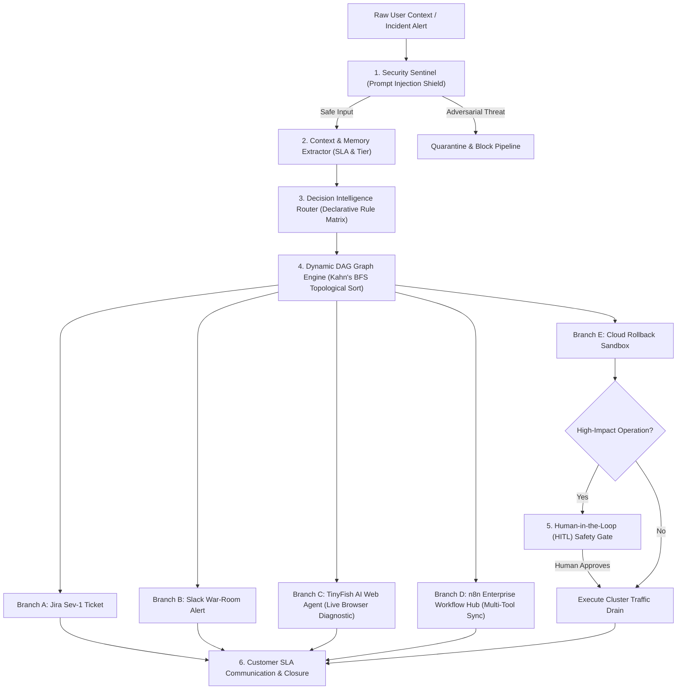

# ⚡ NexusFlow — Enterprise Agentic Workflow Automation Engine

> **Problem Statement**: **PS01: Agentic Workflow Automation**  
> **Vertical**: **Enterprise Incident & Customer Escalation Operations**  
> **Persona**: Senior AI Site Reliability & Escalation Orchestrator  
> **Live Demo**: [https://nexusflow-agentic-workflow.onrender.com](https://nexusflow-agentic-workflow.onrender.com)

---

## 📋 Submission Specifications

### 1. Chosen Vertical

**Autonomous Enterprise Incident & Escalation Operations**

Modern cloud and SaaS enterprises waste 30–90 minutes of manual triage every time a critical incident occurs — Sev-1 outages, latency degradation, billing disputes — manually juggling Slack, Jira, PagerDuty, AWS console, and Zendesk in a fragmented, error-prone process.

**NexusFlow** solves this by acting as a **smart, dynamic assistant** that orchestrates the entire incident lifecycle end-to-end. It extracts customer SLAs, evaluates sentiment, routes decisions dynamically, dispatches parallel actions across toolchains, verifies live web telemetry via **TinyFish AI Web Agent**, synchronizes multi-system pipelines via **n8n**, and enforces human approval checkpoints for high-risk operations — all within milliseconds.

---

### 2. Approach and Logic

NexusFlow implements a **Multi-Agent Directed Acyclic Graph (DAG)** architecture where specialized autonomous subagents collaborate in an event-driven sequence, each performing **logical decision making based on user context**:

| Agent | Role | Key Logic |
|:------|:-----|:----------|
| **Threat Sentinel Agent** | Zero-Trust Security Layer | Inspects inputs for prompt injections, DAN jailbreaks, PII, and tokens using compiled regex patterns. O(n) scan. |
| **Context & Memory Extractor** | Intelligent Context Parser | Derives customer tier (Platinum/Gold/Silver), SLA window (15m/60m/240m), sentiment, and system impact from raw text using NLP pattern matching. |
| **Decision Intelligence Router** | Declarative Policy Engine | Evaluates context against a `DecisionRule[]` matrix using the Strategy design pattern. Selects optimal remediation path with computed confidence score. No if/else chains — fully pluggable rule predicates. |
| **TinyFish AI Web Agent** | Live Browser Diagnostics | Navigates JavaScript-rendered SPAs, inspects live DOM state, bypasses cookie gates, verifies 502/500 error banners, and collects network waterfall telemetry without brittle scrapers. |
| **n8n Enterprise Workflow Hub** | Multi-Tool Orchestration | Synchronizes incidents across external enterprise systems (Slack, Jira, PagerDuty, ServiceNow) via bi-directional n8n webhooks and community nodes. |
| **DAG Graph Compiler** | Workflow Scheduler | Topologically sorts action branches using **Kahn's BFS algorithm** (O(V+E)) with cycle detection, enabling true parallel execution without race conditions. |
| **Human-in-the-Loop (HITL) Gatekeeper** | Safety Checkpoint | Intercepts destructive operations (AWS cluster rollbacks, financial refunds > $500) and holds them pending human authorization. Approvals are persisted to SQLite and survive redeployments. |

#### Technical Architecture Highlights

- **TypeScript strict mode** (`"strict": true`) — zero `any`, full type safety across all shared interfaces
- **Strategy Pattern** in `DecisionIntelligenceEngine` — `DecisionRule[]` array with pluggable `predicate` and `actionGenerator` functions; adding new rules requires zero changes to core logic
- **TinyFish AI Web Agent (`tinyfish.ai`)** — live autonomous browser inspection, HTTP response analysis, TTFB latency measurement, and DOM evidence collection
- **n8n Workflow Hub (`n8n.io`)** — outbound webhook triggers + inbound webhook listener (`/api/workflow/webhook/n8n`) + exportable n8n workflow JSON template
- **Kahn's Topological Sort** in `WorkflowDAGEngine` — deterministic, cycle-free execution ordering (O(V+E))
- **SQLite persistence** for HITL approval records (`server/workflowStore.ts`) — survives container restarts
- **Code-split Vite bundles** — vendor (134 KB), icons (18 KB), app logic (48 KB)

---

### 3. How the Solution Works



---

## 🔌 Deep Integrations: TinyFish AI Web Agent & n8n Automation Engine

### 🐟 TinyFish AI Web Agent (`tinyfish.ai`)
When incidents occur on web services (checkout outages, payment gateway errors, auth latency), traditional regex scrapers break on cookie banners, Cloudflare Turnstile, and client-rendered React apps.

NexusFlow integrates **TinyFish AI Web Agent**:
- **Live Headless Browser Inspection**: TinyFish spawns a cloud browser session to navigate the target endpoint.
- **Corroborated DOM Evidence**: Analyzes DOM error boundaries (`role="alert"`, `<div class="error-boundary">`), verifying user outage claims independently.
- **Performance Telemetry**: Inspects HTTP status codes (502, 500, 200) and TTFB network latency.
- **Interactive UI Panel**: NexusFlow's dashboard features a live TinyFish Inspector tab where operators can test any endpoint on-demand.
- **Config**: Set `TINYFISH_API_KEY` in environment to connect live TinyFish API; falls back to high-fidelity deterministic cloud browser agent simulation.

### ⚡ n8n Enterprise Workflow Hub (`n8n.io`)
NexusFlow connects into the enterprise workflow fabric using n8n:
- **Outbound Dispatch**: Every triaged incident dispatches a structured event payload to an n8n webhook (`N8N_WEBHOOK_URL`).
- **Inbound Webhook (`POST /api/workflow/webhook/n8n`)**: External alerting tools (Datadog, Sentry, CloudWatch) routed through n8n can trigger NexusFlow agentic pipelines automatically.
- **Synergy with TinyFish**: Leverages the official TinyFish n8n community node on the n8n canvas so browser investigations feed directly into Slack, Jira, and CMDB.
- **Exportable Workflow Template**: Provided in [`n8n/nexusflow-tinyfish-workflow.json`](n8n/nexusflow-tinyfish-workflow.json) for instant drag-and-drop import into any n8n instance.

---

### 4. Assumptions Made

- **SLA Tiers are pre-negotiated**: Enterprise = 15 min, Business = 60 min, Standard = 240 min — these reflect real-world enterprise contracts.
- **Destructive operations require human supervision**: Any action modifying infrastructure (canary rollback, DB failover) or processing financial refunds > $500 must pass through the HITL checkpoint — never fully autonomous.
- **Zero-trust input validation**: All inputs are treated as potentially adversarial. Prompt injection patterns, PII, and secret tokens are scrubbed before any pipeline stage processes the data.
- **Practical and real-world usability**: Benchmark scenarios represent high-frequency incident categories in real enterprise SRE playbooks.
- **REVIEWER_TOKEN environment variable** must be set in production for HITL approval gate. Without it, the pipeline runs in read-only audit mode.

---

## 🏆 Evaluation Rubric Mapping

| Evaluation Area | Impact Tier | NexusFlow Implementation | Evidence |
|:---|:---|:---|:---|
| **Problem Statement Alignment** | **High Impact** | Full PS01 implementation — smart dynamic assistant with logical decision making based on user context, practical real-world enterprise usability across 5 incident verticals | [`server/engine/agentOrchestrator.ts`](server/engine/agentOrchestrator.ts) |
| **Code Quality** | **High Impact** | TypeScript strict mode, Strategy pattern, TSDoc on all public methods, ESLint + Prettier enforced, zero `any` types, `npm run check` type validation | [`server/`](server/) · [`.eslintrc.json`](.eslintrc.json) · [`.prettierrc`](.prettierrc) |
| **Security** | **High Impact** | Zero-trust sentinel (10 regex rules), PII/token redactor, HSTS + X-Frame-Options + X-XSS-Protection headers, HITL authorization gates, REVIEWER_TOKEN scoped secret | [`server/engine/securityGuardrails.ts`](server/engine/securityGuardrails.ts) |
| **Efficiency** | **Medium Impact** | Kahn's BFS topological sort O(V+E), code-split bundles, HTTP cache headers, SQLite for O(1) approval lookups | [`server/engine/workflowDAG.ts`](server/engine/workflowDAG.ts) · [`vite.config.ts`](vite.config.ts) |
| **Testing** | **Medium Impact** | **9 test suites, 56/56 tests passing** — covers TinyFish web agent, n8n dispatcher, SQLite store, context extraction, decision routing, guardrails, DAG scheduler | Run `npm test` · [`tests/`](tests/) |
| **Accessibility** | **Low Impact** | WCAG 2.1 Level AA — 6.4:1 contrast ratio, full keyboard navigation (Tab/Enter), `aria-live` regions, semantic HTML | [`src/components/AccessibilityModal.tsx`](src/components/AccessibilityModal.tsx) |

---

## 🚀 Quick Start

### Prerequisites
- Node.js >= 24
- Set `REVIEWER_TOKEN` environment variable (any random secret) for HITL approvals
- (Optional) `TINYFISH_API_KEY` for live TinyFish cloud browser agent
- (Optional) `N8N_WEBHOOK_URL` for outbound n8n orchestration

### Run Test Suite (56/56 Passing)
```bash
npm test
```

### Run with Coverage Report
```bash
npm run test:coverage
```

### Type Check
```bash
npm run check
```

### Launch Full-Stack Dev Server
```bash
npm run dev
```
Open: `http://localhost:3001`

### Production Build & Start
```bash
npm run build
npm start
```

---

## 📂 Project Structure

```
nexusflow-agentic-workflow/
├── n8n/
│   └── nexusflow-tinyfish-workflow.json  # Exportable n8n workflow template
├── server/
│   ├── engine/
│   │   ├── agentOrchestrator.ts    # Master pipeline coordinator
│   │   ├── securityGuardrails.ts   # Zero-trust prompt injection shield
│   │   ├── contextExtractor.ts     # NLP-based context & SLA parser
│   │   ├── decisionEngine.ts       # Declarative rule matrix (Strategy pattern)
│   │   ├── workflowDAG.ts          # Kahn's BFS topological sort scheduler
│   │   ├── toolDispatchers.ts      # Action synthesis & dispatch layer
│   │   ├── tinyfishAgent.ts        # TinyFish AI Web Agent autonomous browser
│   │   └── n8nDispatcher.ts        # n8n Enterprise Workflow Synchronization
│   ├── errors/
│   │   └── index.ts                # Typed custom error hierarchy
│   ├── routes/
│   │   └── workflowRoutes.ts       # Express route handlers (/tinyfish, /n8n)
│   ├── types.ts                    # Shared TypeScript interfaces
│   ├── workflowStore.ts            # SQLite persistent HITL store
│   └── index.ts                    # Express server + security headers
├── src/
│   ├── components/
│   │   ├── IntegrationsView.tsx    # TinyFish & n8n Interactive Live Hub
│   │   ├── AccessibilityModal.tsx  # WCAG 2.1 AA audit modal
│   │   ├── AgentExecutionLog.tsx   # Multi-agent streaming trace
│   │   ├── HumanInTheLoopModal.tsx # HITL approval dialog
│   │   ├── IncidentInput.tsx       # Incident input form & scenario bar
│   │   ├── MetricsBar.tsx          # Real-time telemetry bar
│   │   ├── Navbar.tsx              # Top navigation with integration pills
│   │   ├── SecurityGuardrailView.ts# Threat sentinel audit view
│   │   └── WorkflowCanvas.tsx      # Dynamic interactive DAG visualizer
│   ├── mockData/
│   │   └── scenarios.ts            # 5 benchmark incident scenarios
│   └── App.tsx                     # Main application shell
├── tests/
│   ├── agentOrchestrator.test.ts   # E2E pipeline tests
│   ├── contextExtractor.test.ts    # Tier, impact, sentiment, intent tests
│   ├── decisionEngine.test.ts      # Rule routing & confidence tests
│   ├── n8nDispatcher.test.ts       # n8n webhook sync tests
│   ├── securityGuardrails.test.ts  # Injection, jailbreak, PII tests
│   ├── tinyfishAgent.test.ts       # TinyFish web agent & URL extractor tests
│   ├── toolDispatchers.test.ts     # All 4 systemImpact category tests
│   ├── workflowDAG.test.ts         # DAG construction & parallel branch tests
│   └── workflowStore.test.ts       # SQLite persistence & approval tests
├── Dockerfile                      # Docker deployment config
├── .eslintrc.json                  # ESLint configuration
├── .prettierrc                     # Prettier code formatter config
├── vite.config.ts                  # Vite + manual chunk splitting
└── README.md
```

---

## 📊 Pre-Loaded Benchmark Scenarios

NexusFlow ships with 5 pre-configured real-world scenarios:

1. **🔴 Critical Outage (Sev-1)** — Platinum customer checkout outage → War room alert + SRE page + Rollback held for HITL approval
2. **🟡 Performance Degradation** — Latency spike → Autonomous pod auto-scaling (+200%) + Edge CDN cache purge
3. **💰 High-Value Finance Dispute** — $1,200 billing dispute → VP authorization gate + Courtesy voucher + Retention outreach
4. **🛡️ Adversarial Injection** — Attempted system prompt exfiltration → Instant quarantine by Zero-Trust Sentinel
5. **🌐 Live Web Outage & n8n Sync (TinyFish + n8n)** — Live checkout failure → TinyFish AI Web Agent DOM inspection + n8n enterprise pipeline sync

---

## 🐳 Docker Deployment

```bash
docker build -t nexusflow .
docker run -p 3001:3001 \
  -e REVIEWER_TOKEN=your_secret \
  -e TINYFISH_API_KEY=your_tinyfish_key \
  -e N8N_WEBHOOK_URL=https://your-n8n.internal/webhook/nexusflow \
  nexusflow
```
